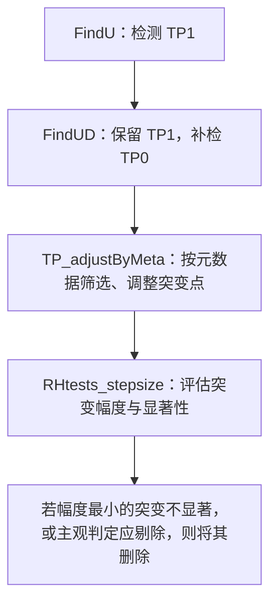

# 输出数据

`StepSize.wRef()` 返回 `data`（序列及订正结果）和 `TP`（突变点及检验结果）。

## `data`：序列及订正结果

| 术语          | 含义                   |
| ------------- | ---------------------- |
| `meanShift`   | 均值跳变               |
| `trend`       | 长期趋势               |
| `annualC`     | 年周期（季节变化）     |
| `QM_adjusted` | 分位数匹配订正后的序列 |
| `deseason`    | 去除季节周期           |

| 变量            | 季节周期 | 趋势 | 均值跳变 |
| --------------- | -------- | ---- | -------- |
| `base`          | 保留     | 保留 | 保留     |
| `base_anomaly`  | 去除     | 保留 | 保留     |
| `base_mean_adj` | 保留     | 保留 | 消除     |

注：`base_mean_adj.ref` 和 `.base` 分别根据目标与参考序列的差值、目标序列自身估计偏移；整体趋势拟合可能受跳变影响。

### `QM_adjusted`：分位数匹配订正

有参考序列时，按突变点分段，默认以最后一段为基准：

1. 将各段目标值排序，分为 `Mq` 类；比较突变前后各类的目标与参考序列差值。
2. 累加相邻突变的分位数订正量，通过样条插值计算各观测值的订正量。
3. 调整订正量，使其均值与均值跳变订正一致；基准段保持不变。

`Mq = 1` 时为均值订正；参考序列缺测较多时会减少分组数。核心代码：[`QMadjGaussian.wRef()`](../R/QMadjGaussian.wRef.R)；无参考序列时使用同文件中的 `QMadjGaussian()`。

## `TP`：突变点及检验结果

| 列名                        | 含义                                                    |
| --------------------------- | ------------------------------------------------------- |
| `kind`、`Idc`               | 突变类型、显著性判断                                    |
| `date`、`Ic`                | 突变日期（`YYYYMMDD`）、在有效差值序列中的位置          |
| `Nseg`                      | 检验所用相邻两段的总样本数                              |
| `stepsize`                  | 根据目标序列拟合得到的均值跳变量                        |
| `prob`、`probL`、`probU`    | 显著性判断所用的概率及其范围，并非通常越小越显著的 p 值 |
| `plev`                      | 置信水平，默认 `0.95`                                   |
| `PFx`                       | PMT 检验统计量，沿用无参考版本的列名                    |
| `PFx95`、`PFx95l`、`PFx95h` | PMT 临界值及其范围                                      |

显著性检验基于目标与参考序列的差值；`stepsize` 则来自目标序列自身的拟合。

# 1 突变点类型

## 1.1 定义

- **有元数据（meta）支持的突变点（TP）**：突变日期与站点迁移、仪器更换等事件日期相差不超过 `maxgap` 天；`TP_adjustByMeta()` 默认 `maxgap = 366`。

## 1.2 变量说明

- `kind`：突变点的检验类型，**不表示是否已经匹配元数据**。
  - **Type-1（`kind = 1`，TP1）**：高确定性的TP，由 `FindU()` 按 PMF 临界值判据检出的突变点，无须元数据支持即可作为候选点保留。
  - **Type-0（`kind = 0`，TP0）**：低不确定性的TP（进一步查漏补缺），由 `FindUD()` 在已有 TP1 基础上，按给定位置的 F 检验判据补检的突变点；本流程要求**后续匹配元数据后才保留**。元数据调整也可将 TP1 转为 TP0。

- `Idc`：显著性判断，与 `kind` 不同。
  - `Yes ` : significant
  - `YifD` : significant if it is documented, i.e., supported by reliable metadata; only for `TP0`
  - `No  ` : not significant
  - `?   ` : may or may not be significant

  > `YifD` 是有条件的显著：只有获得可靠元数据支持后，才能据此认定突变，不能直接等同于 `Yes`。

## 1.3 `FindUD`的后处理：`TP1`与`TP0`的调整 (`TP_adjustByMeta`)

- **保留部分TP0**: TP0中只保留有meta信息支持的TP；

- **保留全部TP1**: 但是有meta信息支持的TP1可以转变为TP0

