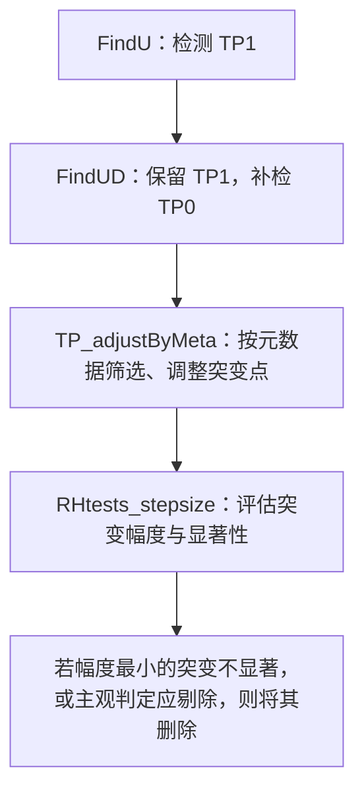

# 1 突变点类型

## 1.1 定义

- **有元数据（meta）支持的突变点（TP）**：突变日期与站点迁移、仪器更换等事件日期相差不超过 `maxgap` 天；`TP_adjustByMeta()` 默认 `maxgap = 366`。

## 1.2 变量说明

- `kind`：突变点的检验类型，**不表示是否已经匹配元数据**。

  - **Type-1（`kind = 1`，TP1）**：高确定性的TP，由 `FindU()` 按 PMF 临界值判据检出的突变点，无须元数据支持即可作为候选点保留。
  
  - **Type-0（`kind = 0`，TP0）**：低不确定性的TP（进一步查漏补缺），由 `FindUD()` 在已有 TP1 基础上，按给定位置的 F 检验判据补检的突变点；本流程要求**后续匹配元数据后才保留**。元数据调整也可将 TP1 转为 TP0。

- `Idc`：显著性判断，与 `kind` 不同。

  - `Yes ` : significant
  - `YifD` : significant if it is documented, i.e., supported by reliable metadata; only for `TP0`
  - `No  ` : not significant
  - `?   ` : may or may not be significant

  > `YifD` 是有条件的显著：只有获得可靠元数据支持后，才能据此认定突变，不能直接等同于 `Yes`。

## 1.3 `FindUD`的后处理：`TP1`与`TP0`的调整 (`TP_adjustByMeta`)

- **保留部分TP0**: TP0中只保留有meta信息支持的TP；

- **保留全部TP1**: 但是有meta信息支持的TP1可以转变为TP0

